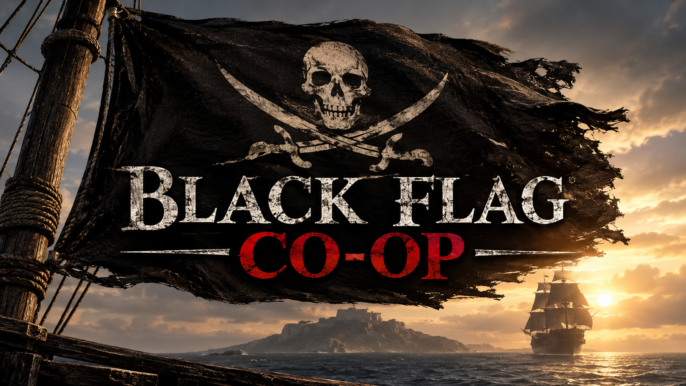

# BlackFlagCoop



**Bringing the original Black Flag co-op vision into Black Flag Resynced.**

**Two Edwards. One Jackdaw. One shared adventure.**

Target: **Assassin's Creed Black Flag Resynced 1.0.6 — Windows x64**.

BlackFlagCoop aims to become the successor to the original BlackFlagCoop project. Our goal is a genuine co-op campaign with two separately rendered, independently controlled Edwards sharing one world.

> **Development status:** early research and engineering. Networking and offline test foundations exist, but a genuine second Edward has not yet been spawned in Resynced. Independent in-game control and playable co-op are not yet achieved. Concept art is illustrative, not gameplay evidence.

## Follow development

- [Project roadmap and milestone acceptance criteria](docs/PROJECT_ROADMAP.md)
- [Development update — 13 November 2026](docs/DEVELOPMENT_UPDATE_2026-11-13.md)
- [GitHub community hub and roadmap tracker](https://github.com/zzyrrup/BlackFlagCoop/issues/45)
- [Share research leads, ideas, or contribute](https://github.com/zzyrrup/BlackFlagCoop/issues/54)

**Current critical path:** prove the Resynced 1.0.6 x64 player/entity creation pipeline before attempting a second Edward. Original AC4 x86 addresses and layouts are behavioral reference only and are not transplanted.

---

Experimental research plugin for **Assassin's Creed IV: Black Flag Resynced** (Windows PC).

This first build is a **safe smoke-test ASI plugin**. It does **not** modify the game, read game memory, install loaders, or call any game APIs. When loaded by an ASI loader in a future test, it only writes a log file.

| Item | Value |
|------|--------|
| Plugin version | `0.5.1` |
| Target game version | `1.0.6` (planned test target) |
| Game executable | `ACBlackFlag.exe` |
| Output | `BlackFlagCoop.asi` (64-bit) |
| Log file | `%LOCALAPPDATA%\BlackFlagCoop\BlackFlagCoop.log` |

## What this plugin does

On `InitializeASI()` it writes:

- Plugin initialization successful
- Plugin version 0.2.0
- Process ID
- Initialization timestamp

## Project layout

```text
BlackFlagCoop/
  CMakeLists.txt
  README.md
  src/
    main.cpp      # DllMain + exported InitializeASI
    logger.cpp    # Safe file logger
    logger.h
```

## Prerequisites (one-time setup)

You need:

1. **Visual Studio 2026** with the workload **Desktop development with C++**
   - This installs the MSVC compiler toolset.
2. **CMake 3.20+**
   - Install from https://cmake.org/download/
   - Or install the **CMake tools for Windows** component from the Visual Studio Installer.

Confirm in a **new** terminal after installing:

```powershell
cmake --version
```

## How to build in Cursor

### Option A — Cursor terminal (recommended)

1. Open this folder in Cursor:  
   `C:\Users\Frees\OneDrive\Documents\BlackFlagCoop`
2. Open the terminal panel in Cursor.
3. Start an **x64 Native Tools** environment, then configure and build:

```powershell
# If you installed Visual Studio 2026 Community:
& "${env:ProgramFiles(x86)}\Microsoft Visual Studio\Installer\vswhere.exe" -latest -products * -requires Microsoft.VisualStudio.Component.VC.Tools.x86.x64 -property installationPath
```

Copy the printed path, then run (example path shown — use yours):

```powershell
# Launch an x64 developer shell from your current Cursor terminal:
cmd /c "`"C:\Program Files\Microsoft Visual Studio\18\Community\VC\Auxiliary\Build\vcvars64.bat`" && powershell"
```

Then inside that shell:

```powershell
cd C:\Users\Frees\OneDrive\Documents\BlackFlagCoop

# Configure an x64 Release build
cmake -S . -B build -G "Visual Studio 18 2026" -A x64

# Compile
cmake --build build --config Release
```

4. Find the plugin here:

```text
build\bin\Release\BlackFlagCoop.asi
```

If your generator places it slightly differently, search with:

```powershell
Get-ChildItem -Path .\build -Recurse -Filter BlackFlagCoop.asi
```

### Option B — Shorter CMake preset-style flow

After `vcvars64.bat` is active:

```powershell
cd C:\Users\Frees\OneDrive\Documents\BlackFlagCoop
cmake -S . -B build -G Ninja -DCMAKE_BUILD_TYPE=Release
cmake --build build
```

Ninja output is typically:

```text
build\bin\BlackFlagCoop.asi
```

> Ninja is optional. The Visual Studio generator in Option A is enough.

### Option C — Visual Studio UI

1. Install Visual Studio 2026.
2. In Cursor/VS, open the folder or open `CMakeLists.txt`.
3. Select configuration **x64-Release**.
4. Build the `BlackFlagCoop` target.
5. Collect `BlackFlagCoop.asi` from the build output folder.

## Important safety rules

- Do **not** copy this `.asi` into the game directory yet.
- Do **not** install `version.dll` / Ultimate ASI Loader yet.
- Do **not** modify: `C:\Games\AC Black Flag Resynced`
- This milestone only proves we can compile a valid x64 ASI-shaped DLL.

## Manual load test (later — not now)

When we intentionally test loading later, an ASI loader would call:

```cpp
extern "C" __declspec(dllexport) void InitializeASI()
```

Then you would check:

```powershell
notepad $env:LOCALAPPDATA\BlackFlagCoop\BlackFlagCoop.log
```

## Troubleshooting

| Problem | What to try |
|---------|-------------|
| `cmake` not recognized | Install CMake and restart Cursor |
| No MSVC compiler | Install VS 2026 with **Desktop development with C++** |
| 32-bit build | Always pass `-A x64` (or use `vcvars64.bat`) |
| Build folder messy | Delete `build\` and re-run CMake configure |

## Networking tests (v0.4.0)

Standalone networking milestone: TCP session handshake plus player **presence** and
periodic **placeholder state** (player ID, connection status, x/y/z). These are not
real in-game coordinates and do not use game memory hooks.

Build:

```powershell
cmake -S . -B build -G "Visual Studio 18 2026" -A x64
cmake --build build --config Release
```

### Localhost regression (same PC)

```powershell
powershell -ExecutionPolicy Bypass -File .\scripts\Run-LocalhostNetTest.ps1
```

### LAN host/client (two PCs)

On the host PC (`10.0.0.95`):

```powershell
powershell -ExecutionPolicy Bypass -File .\scripts\Run-LanHost.ps1
```

Review the firewall helper first (does nothing until you approve):

```powershell
powershell -ExecutionPolicy Bypass -File .\scripts\Show-LanFirewallCommand.ps1
```

On the second PC (after copying `BlackFlagCoopNetTest.exe`):

```powershell
powershell -ExecutionPolicy Bypass -File .\scripts\Run-LanClient.ps1
```

Equivalent manual commands:

```powershell
.\build\bin\Release\BlackFlagCoopNetTest.exe --host --bind 0.0.0.0 --port 27016
.\build\bin\Release\BlackFlagCoopNetTest.exe --client --connect 10.0.0.95 --port 27016
```

This console test app is separate from the ASI and is never installed into the game folder.
Do not claim LAN success until a real second PC connects.

## Current status

- [x] x64 CMake + MSVC project
- [x] `InitializeASI` export
- [x] LocalAppData logging
- [x] Startup splash
- [x] Init once-only protection
- [x] Winsock networking foundation
- [x] Localhost host/client test
- [x] LAN host/client harness prepared (`0.0.0.0` / `10.0.0.95:27016`)
- [x] Player presence + placeholder state sync (standalone NetTest)
- [ ] Real in-game position synchronization
- [ ] Wi-Fi / internet connectivity
- [ ] Game memory hooks
- [ ] Gameplay synchronization


## Startup splash (0.2.0 development)

The plugin now requests a temporary, non-activating Windows splash overlay after
`InitializeASI()` succeeds. It displays `BlackFlagCoop_splash.png` from the same
directory as `BlackFlagCoop.asi`, holds for about 3.5 seconds, then fades over
about 0.7 seconds. If the PNG is absent or cannot be decoded, a text-only
BLACK FLAG CO-OP fallback is drawn.

This is a desktop overlay, not an in-engine rendering hook. It does not modify
the game menu or render pipeline. Some exclusive-fullscreen configurations may
not display desktop overlays above the game. Test offline first.

The splash is optional: keep `BlackFlagCoop_splash.png` beside the `.asi`.
The build links against Windows GDI+ (`gdiplus.lib`).
